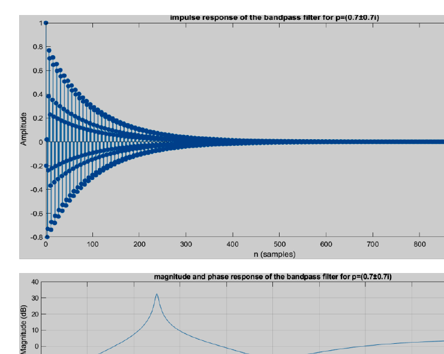
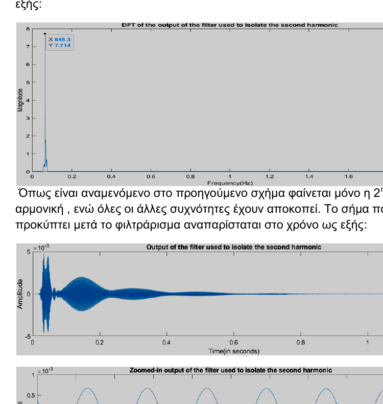
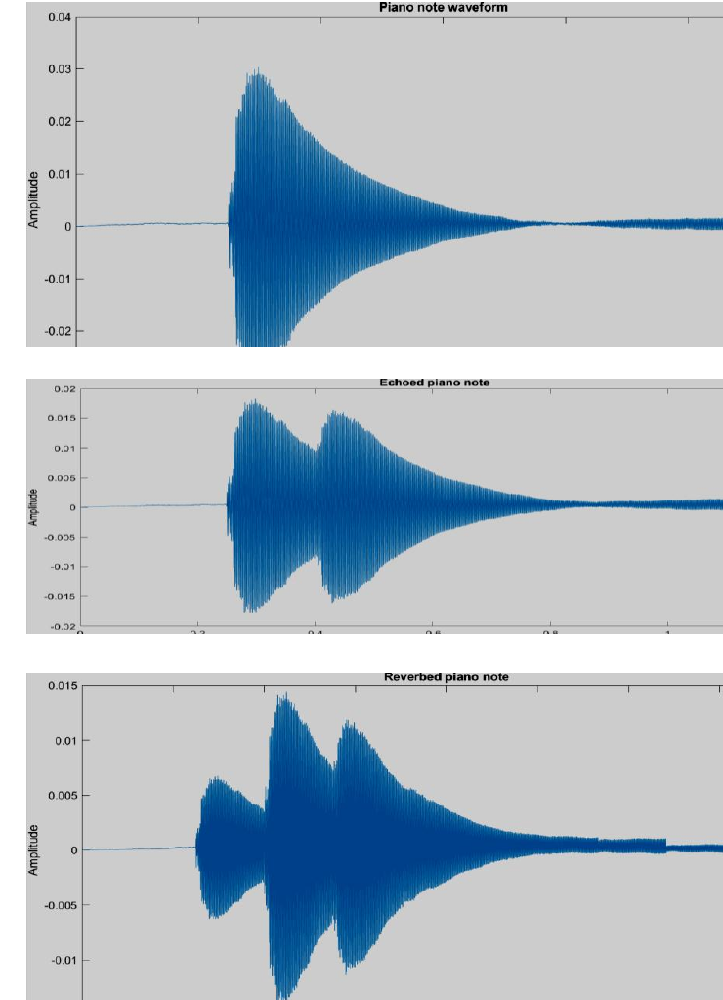

# Signals and Systems - MATLAB DSP Project

MATLAB implementations of fundamental digital signal-processing techniques, including digital filter design, pole-zero analysis, FFT-based spectral analysis, harmonic isolation, and audio effects.

This project was developed for the **Signals and Systems** course at the **School of Electrical and Computer Engineering, National Technical University of Athens (NTUA)** during the 2020-2021 academic year.

## Overview

The project connects core discrete-time signals and systems theory with practical MATLAB experiments. It begins with analytical filter design and stability analysis, then applies those filters to real musical signals.

The main topics are:

- FIR echo filters and cascaded reverberation filters
- inverse filtering / dereverberation
- pole-zero analysis and system stability
- band-pass filter design
- impulse, step, magnitude, and phase responses
- DFT / FFT spectral analysis
- Hamming-window energy analysis
- fundamental-frequency and harmonic analysis
- isolation of selected harmonics from musical recordings
- echo and reverberation effects on audio signals

## 1. Digital Filter Design

### Echo and reverberation

The project implements a simple discrete-time echo system

[
y[n] = c x[n] + (1-c)x[n-P],
]

and studies how the delay parameter `P` changes the frequency response, pole-zero representation, and impulse response. A third-order reverberation effect is created by cascading three echo filters.

An inverse filter is also constructed and tested for dereverberation.

### Band-pass filters and stability

Band-pass filters are designed directly from poles and zeros. The experiments show how moving poles toward, onto, and outside the unit circle affects selectivity, impulse-response decay, and stability.

<p align="center">
  
</p>

## 2. Musical Signal Analysis

A viola recording sampled at **44.1 kHz** is analyzed in both the time and frequency domains. The workflow includes:

- waveform visualization
- signal-energy estimation using a 1000-sample Hamming window
- FFT-based spectrum calculation
- isolation of an individual note
- estimation of the note period and fundamental frequency
- inspection of higher-order harmonics

The project then uses band-pass filtering to isolate selected harmonics of a viola note.

<p align="center">
  
</p>

## 3. Echo and Reverb on Audio

The final part applies the filters to a piano recording. With a sampling rate of 44.1 kHz, a 0.15 s echo corresponds to a delay of **6615 samples**. Three cascaded echo filters are used to create reverberation, and the resulting signals are compared in the time and frequency domains.

<p align="center">
  
</p>

The project also investigates when an echo is no longer perceptually distinguishable and how small delay mismatches affect dereverberation.

## Repository Structure

```text
signals-and-systems-matlab/
├── README.md
├── src/
│   ├── signals_systems_project.m
│   └── scaledata.m
├── experiments/
│   └── harmonic_filter_design.m
├── audio/
│   ├── README.md
│   ├── input/
│   └── output/
├── assets/
│   ├── pole-stability-response.png
│   ├── harmonic-isolation.png
│   └── echo-reverb-comparison.png
└── docs/
    ├── README.md
    └── report.pdf
```

## Running the Project

### Requirements

- MATLAB
- Signal Processing Toolbox

### Audio data

The recordings supplied with the original university assignment are **not redistributed** here. To reproduce the audio experiments, place the following files in `audio/input/`:

```text
viola_series.wav
viola_note.wav
piano_note.wav
```

Then run:

```matlab
run('src/signals_systems_project.m')
```

Generated echo and reverb audio is written to `audio/output/`.

## Files

- `src/signals_systems_project.m` - main implementation for the complete assignment
- `src/scaledata.m` - helper for linear amplitude rescaling
- `experiments/harmonic_filter_design.m` - alternative pole-zero experiment for harmonic isolation
- `docs/report.pdf` - original project report with personal identifiers redacted for public sharing

## Notes

This repository is a cleaned portfolio version of a university project. The implementation remains close to the original coursework so that the repository reflects the work completed at the time, while the repository structure, documentation, paths, and privacy-sensitive material have been cleaned for public presentation.

## Author

**Ioannis Litsos**  
Electrical and Computer Engineering, NTUA
